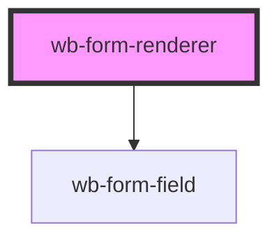

# wb-form-renderer

<!-- Auto Generated Below -->

## Properties

| Property | Attribute | Description                                                                                                                                                                                                           | Type          | Default     |
| -------- | --------- | --------------------------------------------------------------------------------------------------------------------------------------------------------------------------------------------------------------------- | ------------- | ----------- |
| `fields` | --        |                                                                                                                                                                                                                       | `FieldMeta[]` | `[]`        |
| `values` | --        | Prefill values keyed by each data field's submission name (`field.<id>`) — the same shape `wbSubmit` emits, so a saved payload can be passed back verbatim. Applied on first render and whenever this object changes. | `string`      | `undefined` |

## Events

| Event      | Description | Type                  |
| ---------- | ----------- | --------------------- |
| `wbSubmit` |             | `CustomEvent<string>` |

## Methods

### `setFields(fields: FieldMeta[]) => Promise<void>`

#### Parameters

| Name     | Type          | Description |
| -------- | ------------- | ----------- |
| `fields` | `FieldMeta[]` |             |

#### Returns

Type: `Promise<void>`

### `setValues(values: Record<string, string>) => Promise<void>`

Applies a prefill object imperatively, equivalent to setting `values`.

#### Parameters

| Name     | Type                       | Description |
| -------- | -------------------------- | ----------- |
| `values` | `{ [x: string]: string; }` |             |

#### Returns

Type: `Promise<void>`

## Dependencies

### Depends on

- [wb-form-field](../wb-form-field)

### Graph

----------------------------------------------

*Built with [StencilJS](https://stenciljs.com/)*
